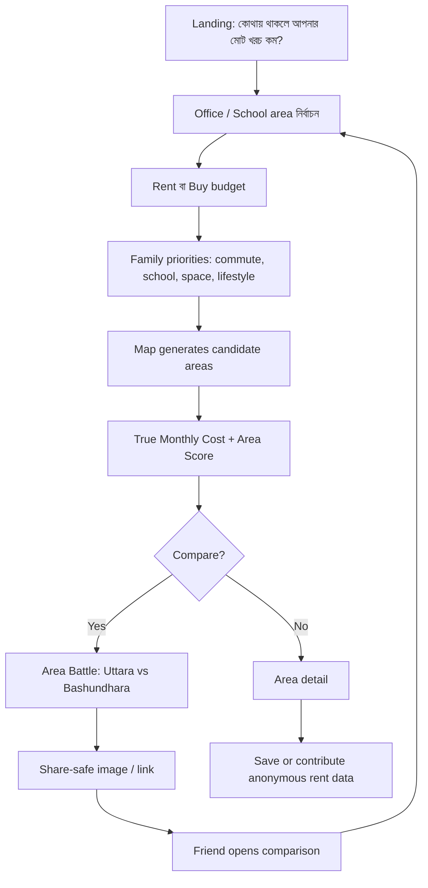
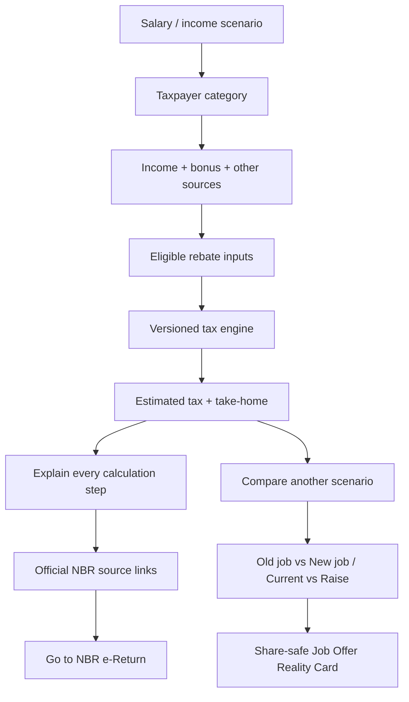
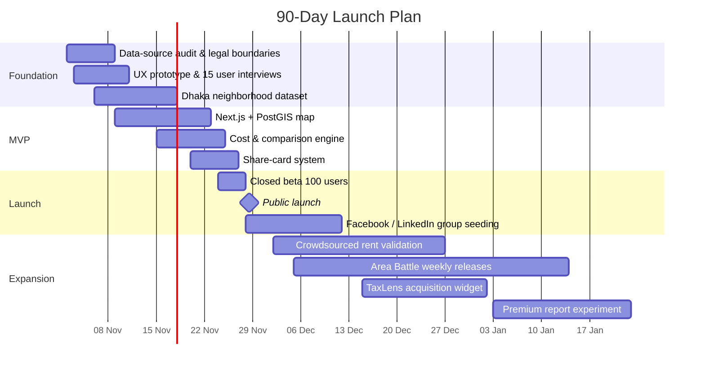

# বাংলাদেশে ভাইরাল হওয়ার সম্ভাবনাময় Next.js Finance/Map Web App: Deep Research Report

## নির্বাহী সারাংশ

বাংলাদেশে “ভাইরাল” হওয়ার মতো একটি ওয়েব অ্যাপ বানানোর ক্ষেত্রে সবচেয়ে গুরুত্বপূর্ণ সিদ্ধান্ত হলো **আরেকটি generic calculator, expense tracker, map directory বা property listing site না বানানো**। ইতিমধ্যেই tax calculator, property marketplace, card-offer aggregator এবং সরকারি map/land portals আছে। বরং সুযোগটি রয়েছে **বিচ্ছিন্ন public data + ব্যক্তিগত decision-making + shareable visual output** একসঙ্গে আনার মধ্যে। বাংলাদেশের ২০২৬ সালের ডিজিটাল বাজারে এই কৌশল কার্যকর হওয়ার পক্ষে যথেষ্ট ভিত্তি আছে: BTRC এপ্রিল ২০২৬-এ ১৩১.৪২ মিলিয়ন internet subscriptions গণনা করেছে; DataReportal-এর late-2025 estimate অনুযায়ী ৬৪ মিলিয়ন social-media identities এবং Facebook-এও প্রায় ৬৪ মিলিয়ন potential ad reach ছিল। একই সময়ে Messenger-এর potential reach ছিল ৩৫ মিলিয়ন। এগুলো unique users নয়, কিন্তু Facebook/Messenger-কেন্দ্রিক sharing loop যে বাংলাদেশের জন্য গুরুত্বপূর্ণ, তার শক্তিশালী ইঙ্গিত দেয়। তোমার নির্ধারিত middle/high-income segment আরও আকর্ষণীয়। Bangladesh Bank-ভিত্তিক সাম্প্রতিক তথ্যে নভেম্বর ২০২৫ নাগাদ credit-card users প্রায় ২.৮৮৬ মিলিয়নে পৌঁছেছিল, এবং Bangladesh Bank-এর ২০২৬ সালের card study অনুযায়ী মোট debit, credit ও prepaid cards সেপ্টেম্বর ২০২১-এর ২৭.০১ মিলিয়ন থেকে আগস্ট ২০২৬-এ ৫২.৯৫ মিলিয়নে উঠেছে। অন্যদিকে Visa-র ২০২৪ transaction analysis-এ প্রায় ৮০% digital transactions ঢাকা-কেন্দ্রিক ছিল। অর্থাৎ premium digital-finance audience ছোট নয়, কিন্তু ভৌগোলিকভাবে concentrated—যা Dhaka-first launch-এর পক্ষে যায়। আরেকটি গুরুত্বপূর্ণ পরিবর্তন হলো tax behavior। NBR বলছে ২০২৬–২০২৭ করবর্ষে সাধারণভাবে individual taxpayers-এর জন্য e-Return বাধ্যতামূলক হয়েছে, কিছু নির্দিষ্ট exemption বাদে; NBR-এর e-Return registration-এর জন্য TIN এবং biometric-registered mobile number প্রয়োজন। ফলে tax-related decision support এখন niche utility নয়—একটি বড় recurring annual use case। এই গবেষণার ভিত্তিতে আমার ranking-এ **সবচেয়ে শক্তিশালী তিনটি product direction** হলো:

| Rank | Concept | Viral potential | Affluent fit | Regulatory risk | Data moat | MVP difficulty | Verdict |
|---|---|---:|---:|---:|---:|---:|---|
| 1 | **বাসাIQ / Dhaka Decision Map** — neighborhood financial + lifestyle intelligence | 9/10 | 10/10 | Low–Medium | Very high | Medium | **সেরা সুযোগ** |
| 2 | **TaxLens BD** — salary, tax, rebate ও financial scenario engine | 8.5/10 | 9/10 | Medium | High | Medium | **দ্রুত launchযোগ্য** |
| 3 | **CardMap BD** — “এই জায়গায় কোন card ব্যবহার করলে সবচেয়ে বেশি বাঁচবে?” | 8/10 | 10/10 | Low | Medium | Medium | **দ্রুত viral loop** |
| 4 | NRB Money Route — expatriate family remittance/FX planner | 7.8/10 | 9/10 | Medium–High | High | Medium | Diaspora niche |
| 5 | Property Due-Diligence Map | 7.6/10 | 10/10 | Medium | Very high | High | High-trust product |
| 6 | Salary Reality Index BD | 7.3/10 | 9/10 | Low | High | Low–Medium | Shareability strong |
| 7 | Commute Cost Map | 7.1/10 | 8/10 | Low | Medium | Medium | Good acquisition tool |
| 8 | Home-Loan Affordability Map | 6.9/10 | 10/10 | Medium | Medium | Medium | Monetizable |
| 9 | Entrepreneur Cashflow & Tax Scenario Lab | 6.7/10 | 9/10 | Medium | Medium | Medium | B2B potential |
| 10 | Bangladesh Safe-Yield Radar | 6.3/10 | 9/10 | Medium–High | Medium | Medium | Compliance-sensitive |

**একটি মাত্র product বানাতে হলে আমার পছন্দ হবে বাসাIQ।** কারণ এটি property site নয়; এটি “আমি কোথায় থাকব/কিনব?” প্রশ্নের decision engine। ব্যবহারকারী Gulshan বনাম Bashundhara, Dhanmondi বনাম Uttara, Mirpur DOHS বনাম Purbachal তুলনা করবে এবং একটি shareable result পাবে: *“Uttara-তে গেলে বছরে ৳২.৪ লাখ কম housing+commute cost, কিন্তু school commute +২৬ মিনিট”*। বাংলাদেশের বর্তমান portals-এ property prices, listings, land maps বা DAP data আলাদাভাবে পাওয়া যায়; একটিও affluent household-এর জন্য integrated financial-location decision score হিসেবে উপস্থাপিত নয়। BProperty ইতিমধ্যে listings, geolocation, valuation, rental-yield ও suburb insights দেয় এবং Bikroy area-wise asking-price statistics দেয়; তাই শুধু “property price map” বানালে differentiation থাকবে না। এই recommendation একটি বাজার-ভিত্তিক inference: বাংলাদেশের digital payments ও property/card ecosystems যথেষ্ট mature, কিন্তু user-facing decision intelligence এখনো fragmented। সরকারি RAJUK GIS, DAP data, DLRS map systems ও land-service portals থাকার অর্থ হলো location intelligence-এর public-data foundation আগে থেকেই তৈরি হচ্ছে। ## বাজার, ব্যবহারকারী ও ভাইরাল হওয়ার বাস্তব শর্ত

### কাদের জন্য বানানো উচিত

প্রাথমিক target “বাংলাদেশের সবাই” হওয়া উচিত নয়। প্রথম ৬ মাসে চারটি narrow persona ধরলে product-market signal দ্রুত পাওয়া যাবে।

**Urban salaried professionals, বয়স আনুমানিক ২৬–৪৫:** ব্যাংক/টেলিকম/tech/FMCG/MNC/NGO/consulting/medical/legal sectors-এর professionals, যাদের বাসা নির্বাচন, tax, credit card, school commute এবং lifestyle spending গুরুত্বপূর্ণ। বাংলাদেশের ২০২২ HIES-এ urban household-এর average monthly income ছিল Tk 45,757—national average Tk 32,422-এর চেয়ে বেশি—যদিও এই পুরনো national average affluent threshold নয়; বরং urban concentration বোঝার reference হিসেবে উপযোগী। **Upper-middle/high-income families:** rent বা apartment purchase, school, hospital, commute, service charge, generator/IPS, parking, security এবং neighborhood quality—সব একসঙ্গে বিবেচনা করে। বর্তমান property portals মূলত listing ও price-centric; BProperty-এর current feature set-এ valuation, rental-yield analysis ও suburb trends আছে, যা demand প্রমাণ করে, তবে cross-domain household-cost decision layer এখনও আলাদা সুযোগ। **Entrepreneurs / SME owners:** personal salary, business income, tax, property ও liquidity decisions overlap করে। NBR-এর Income Tax Act 2023 এখনও central legal framework এবং ২০২৫ পর্যন্ত amendments/English authentic text NBR প্রকাশ করেছে; ফলে calculation engine-এ versioned rules অপরিহার্য। **NRBs / expatriates:** property purchase, পরিবারের living cost, remittance এবং FX গুরুত্বপূর্ণ। শুধু আগস্ট ২০২৬-এ workers’ remittance ছিল প্রায় US$2.968 billion; জুলাই–আগস্ট FY2026-27-এ remittance আগের বছরের তুলনায় 18.9% বেশি ছিল। UK, USA, Saudi Arabia, UAE, Italy, Malaysia ইত্যাদি থেকে বড় flows এসেছে। ### মানুষ কেন share করবে

ভাইরাল product-এর result “useful” হওয়াই যথেষ্ট নয়; result-এ **identity, surprise বা social comparison** থাকতে হবে। Bangladesh-specific finance/map products-এর জন্য চারটি share trigger সবচেয়ে বাস্তবসম্মত:

**“আমি বনাম অন্যরা”** — “আপনার salary Dhaka professionals-এর কোন percentile?” বা “আপনার rent-to-income ratio আপনার area-র তুলনায় কত?”; তবে benchmark শুধুমাত্র sufficiently aggregated dataset থেকে দিতে হবে।

**“A বনাম B”** — Dhanmondi vs Uttara, Gulshan vs Bashundhara, Visa vs Amex, current salary vs new job offer। Comparison screenshot Facebook/Messenger group-এ naturally shareable।

**“আমি কত টাকা হারাচ্ছি/বাঁচাতে পারি”** — বছরে অতিরিক্ত commute cost, unused card benefit, tax-rebate gap, rent premium। মানুষের attention percentage-এর চেয়ে absolute টাকা বেশি টানে—এটি product-design inference, research statistic নয়।

**“আমার result তুমি দেখো”** — spouse, colleague, family বা diaspora-relative-কে private link পাঠানো। বিশেষত house decision ও tax planning inherently multi-person decisions।

Public share card-এ কখনও exact salary, TIN, NID, exact home location বা raw transaction information default হিসেবে দেখানো উচিত নয়। বাংলাদেশের Personal Data Protection Act 2026 consent-কে informed, specific এবং freely given positive indication হিসেবে সংজ্ঞায়িত করেছে; immediate geolocation-কে sensitive personal data-এর মধ্যে অন্তর্ভুক্ত করেছে এবং data security-র জন্য appropriate technical/organizational measures চায়। ## নির্দিষ্ট product concepts: ranked shortlist

### বাসাIQ — Dhaka Decision Map

এটি property marketplace নয়; “কোন এলাকায় বাসা নেওয়া আমার পরিবারের জন্য financially smartest?”—এই প্রশ্নের interactive map। ব্যবহারকারী salary range, office location, school location, rent/buy budget, car/ride-share preference এবং priorities দেবে। Result হবে neighborhood-level **True Monthly Cost**, commute cost, estimated rent/property range, DAP land-use context, hospitals/schools proximity, user-reported service charge, parking এবং একটি confidence score। RAJUK-এর Enterprise GIS ও DAP map data, সরকারি land-map ecosystem এবং public property asking-price data location layer তৈরির ভিত্তি দিতে পারে। Viral object হবে **“Area Battle Card”**: “Bashundhara vs Uttara — আপনার পরিবারের জন্য Uttara বছরে ৳X সস্তা, Bashundhara commute-এ Y ঘণ্টা বাঁচায়।” exact address নয়, area-level result। Monetization পরে developer leads, home-loan leads, premium reports, movers/interior/ISP referrals এবং verified property intelligence subscription থেকে হতে পারে; শুরুতে referral ছাড়াই product useful থাকতে হবে।

### TaxLens BD — Personal Tax & Salary Scenario Engine

Simple calculator নয়। এটি “আমার নতুন salary package নিলে actual take-home কত?”, “bonus পেলে tax impact?”, “investment rebate gap কত?”, “salary + rent + business income থাকলে approximate liability?”—এসব scenario side-by-side দেখাবে। Current NBR system already return filing করে, আর TaxHisab ও BD Tax Calculator basic/detailed estimation দেয়; তাই differentiation হবে **scenario planning + salary negotiation + explainable calculations + versioned rule engine + share-safe comparison**, filing নয়। Viral object: **“Job Offer Reality Card”**—“৳150k → ৳180k gross increase = estimated after-tax annual gain ৳X”—যেখানে exact salary hide করার toggle থাকবে। Annual filing season acquisition spike থাকবে, কিন্তু salary-offer comparison feature সারা বছর ব্যবহারযোগ্য করবে। NBR-এর ২০২৬–২০২৭ e-Return mandate এটিকে বিশেষ timely করে। ### CardMap BD — Nearby Card Savings Map

ব্যবহারকারী তার cards manually select করবে—bank login নয়, card number নয়। Map খুলে দেখাবে কাছাকাছি restaurant, hotel, hospital, retail store বা travel merchant-এ **কোন card ব্যবহার করলে আজ সবচেয়ে বেশি effective saving**। প্রতিটি offer-এর expiry, minimum spend, cap, eligible card type, weekend restriction ও official source থাকবে। Bangladesh market-এ OfferTracker BD, CardiBee, Offer Koi এবং AllOfBD ইতিমধ্যে aggregator হিসেবে কাজ করছে; তাই শুধু offer-list করলে competitive advantage থাকবে না। differentiation হতে হবে **map-first + “best card for this bill” calculator + verified expiry + group bill optimization**। Viral object: “আজ Gulshan-এ dinner? আপনার wallet-এর best card = X, estimated saving ৳1,200।” Banks নিজেরাই location-specific ও eligibility-specific offer publish করে; City Bank-এর current offer pages-এ merchant location, weekend limits, minimum spending এবং card tiers আলাদা করে দেখা যায়, অর্থাৎ structured normalization-এর স্পষ্ট utility আছে। ### NRB Money Route

প্রবাসী ও তার বাংলাদেশি পরিবারের জন্য একটি non-transactional “money command center”: Bangladesh Bank official FX reference rate, monthly remittance trends, family-budget targets, home-purchase saving goal, education/medical goal এবং bank/remittance-provider published fee inputs side-by-side। এটি নিজে টাকা পাঠাবে না। Bangladesh Bank cross-border foreign-exchange activity কঠোরভাবে regulate করে; MFS framework domestically cross-border transfer allow করে না, যদিও banking channel-এর inward remittance local disbursement সম্ভব। তাই product-টি প্রথম পর্যায়ে information/planning layer হওয়াই নিরাপদ। Viral loop private-family oriented: “এই মাসে UK→Bangladesh family goal 82% complete”, “USD/BDT impact on apartment fund”, shared family dashboard। Monetization পরে regulated partners-এর referral, premium family planning, property due-diligence reports।

### Property Due-Diligence Map

Plot/flat কিনতে যাওয়ার আগে একটি checklist map: DAP land-use classification, official mouza/map links, available survey type, mutation/land-tax service links, flood/water-body proximity warning, nearby road/utility context, developer/project links এবং manually uploaded deed checklist। এটি ownership certify করবে না। সরকারি DLRS portal CS/SA/RS/BRS/BDS maps search/purchase করতে দেয় এবং land portals mutation, land-development tax, records/maps ইত্যাদি services list করে। High-income user-এর কাছে এর value অনেক, কারণ property transaction high-stakes। Viral spread mass-market entertainment-এর মতো হবে না; বরং family, lawyers, brokers ও NRB community-তে trust-driven referral হবে। Premium due-diligence report monetization সম্ভব, তবে “legal verification” claim না করে “decision-support checklist” বলা উচিত।

### Salary Reality Index BD

Anonymous, aggregated salary benchmarking—industry, role, years of experience, city, company type অনুযায়ী। User salary দিলে “percentile”, estimated tax, rent affordability এবং comparable roles দেখাবে। Shareable card হবে exact salary না দেখিয়ে “Top 18% among Dhaka Product Managers, 5–8 yrs experience।” এটি LinkedIn/Facebook professional groups-এ strong identity-sharing loop তৈরি করতে পারে; DataReportal late-2025 অনুযায়ী LinkedIn Bangladesh-এ ১২ মিলিয়ন registered members দেখাচ্ছিল, যদিও এটি active-user count নয়। মূল ঝুঁকি হলো fake submissions এবং small cohorts থেকে individual inference; cohort threshold, outlier removal, employer-level data delay এবং privacy-preserving aggregation লাগবে।

### Commute Cost Map

Office + home + travel mode দিয়ে মাসিক commute-এর monetary এবং time cost দেখাবে। তারপর map-এ দেখাবে “আপনার total housing + commute budget-এ কোন এলাকাগুলো realistic।” এটি বাসাIQ-এর acquisition product হিসেবেও independently launch করা যায়। এর বিশেষ value হলো rent-only comparison-এর বদলে “true cost of location”। Map data OSM-derived provider দিয়ে করা যায়, কিন্তু production scale-এ free `tile.openstreetmap.org`-কে unlimited CDN ধরে নেওয়া যাবে না; OSM Foundation স্পষ্ট করে যে OSM data free হলেও standard tile servers সীমিত-capacity এবং usage policy-এর অধীন। ### Home-Loan Affordability Map

User income, down payment, loan tenure এবং estimated rate দিলে শুধু EMI নয়—map-এ দেখাবে budget অনুযায়ী কোন Dhaka neighborhoods-এ typical asking-price range fit করতে পারে। BProperty ইতিমধ্যে home-loan comparisons এবং valuation-related features দেয়; তাই differentiation হবে income→affordability→map→area comparison flow। Bank-specific personalized loan approval predict করা উচিত নয়; “illustrative affordability” বলতে হবে। পরে bank referral সম্ভব, কিন্তু lending decision বা loan brokerage করলে Bangladesh Bank licensing/compliance analysis আলাদাভাবে লাগবে।

### Entrepreneur Cashflow & Tax Scenario Lab

SME founder নিজের monthly revenue, salary draw, rent, recurring costs এবং taxable income assumptions দিয়ে “what-if” scenario বানাবে। Accountant replacement নয়; board-style cash runway + estimated personal/business tax reminders + VAT/source-tax reference links। Monetization premium export/accountant collaboration। Tax rules frequently amend হওয়ায় versioned legal rules এবং effective-date architecture বাধ্যতামূলক। NBR current Income Tax Act repository একই আইনের amendments এবং updated texts প্রকাশ করে। ### Bangladesh Safe-Yield Radar

FDR/DPS/government securities/savings instruments-এর publicly published rates, lock-in, tax impact এবং inflation-adjusted approximate return side-by-side। Conceptটি attractive হলেও regulatory ভাষা অত্যন্ত সাবধানে ব্যবহার করতে হবে: “recommendation” বা “best investment for you” না বলে comparison/information। ভবিষ্যতে personalized investment recommendation বা execution যোগ করলে capital-market/banking regulation review অপরিহার্য। ফলে প্রথম product হিসেবে আমি এটি recommend করছি না।

## শীর্ষ ধারণাগুলোর বিস্তারিত নকশা

### বাসাIQ: product architecture

**MVP features**

| Feature | MVP | Post-MVP |
|---|---|---|
| Interactive Dhaka neighborhood map | ✓ | Chattogram/Sylhet |
| Rent / asking-price range | ✓ | Transaction-verified index |
| Office commute estimate | ✓ | Time-of-day model |
| Housing + commute “True Cost” | ✓ | School + utility + parking |
| Area-vs-area comparison | ✓ | 3–5 area portfolio |
| DAP land-use overlay/link | ✓ | Parcel intelligence |
| Schools/hospitals/metro proximity | ✓ | Quality scoring |
| Anonymous user-reported rent/service charge | ✓ | Verified submissions |
| Shareable Area Battle image | ✓ | personalized monthly report |
| Accounts | optional | ✓ |
| Exact property listings | ✗ | partner integration |
| Payment handling | ✗ | preferably never initially |

RAJUK বর্তমানে DAP/Enterprise GIS portal চালায় এবং ArcGIS-hosted DAP layers publicly discoverable; DLRS ও Ministry of Land-এর portals map/records infrastructure দেয়। তবে public web availability মানেই unrestricted bulk API reuse নয়—terms, rate limits ও licensing আলাদাভাবে verify করে integration করতে হবে। Property pricing-এর MVP data হিসেবে নিজের crowdsourced submissions + openly visible listing aggregates ব্যবহার করা নিরাপদতর; competitor pages scrape করে proprietary dataset পুনঃপ্রকাশের বদলে source agreements বা user-contributed observations গড়া উচিত। Bikroy-এর Dhaka statistics page ইতিমধ্যে area-level advert counts এবং prices দেখায়, আর BProperty suburb analytics দেয়—এগুলো user demand validate করে, dataset copying-এর অনুমতি নয়। **User flow**



এই flow-এর viral loop intentional: receiver একটি static marketing page না পেয়ে নিজের scenario edit করতে পারে। অর্থাৎ share → personalized remix → নতুন share।

**Recommended stack:** Next.js App Router + TypeScript; PostgreSQL/PostGIS; Drizzle বা Prisma; MapLibre GL JS; managed OSM-derived tiles/MapTiler-type provider; background data normalization worker; Redis-compatible cache; S3-compatible object storage; server-generated OG/share cards। Next.js App Router Server Components, Server Functions এবং Route Handlers support করে, তাই SEO landing pages, calculation APIs এবং authenticated dashboards একই codebase-এ রাখা সম্ভব। শুরুতে Vercel Hobby technical testing-এর জন্য যথেষ্ট হতে পারে, কিন্তু Vercel নিজেই Hobby-কে personal/non-commercial use হিসেবে বর্ণনা করে; monetization শুরু হলে deployment plan পুনর্বিবেচনা করা উচিত। Hobby-তে current usage limits-ও আছে। **Privacy design:** exact home latitude/longitude database-এ defaultভাবে রাখবে না; browser-side location ব্যবহার করলে coarse geohash-এ transform; share result-এ 500m–1km generalized area; raw location logs short retention। কারণ current law immediate geolocation-কে sensitive personal data হিসেবে categorise করে। **Development estimate:** একজন experienced full-stack developer + part-time designer/data researcher হলে ৪–৬ সপ্তাহে credible Dhaka MVP; solo developer হলে ৬–৮ সপ্তাহ realistic। সবচেয়ে বেশি সময় code নয়, area boundaries, source validation এবং usable scoring model-এ যাবে—এটি project estimate, external fact নয়।

**৯০ দিনের লক্ষ্য:** ২০–৩০ high-interest Dhaka neighborhoods → user-contributed cost dataset → weekly “Area Battle” releases → school/office commute → basic property affordability → Purbachal/land-intelligence pilot।

### TaxLens BD: product architecture

TaxLens-এর design principle হওয়া উচিত **“explain every taka.”** NBR-এর e-Return system filing-এর system of record; তুমি filing replace করবে না। NBR বর্তমানে eTIN, eReturn, ReturnVerify/PSR, Tax Representative Management এবং eTaxPayment services একত্রে দেয়। Existing TaxHisab already quick/detailed calculation, rule tracing ও downloadable PDF দেয় এবং BD Tax Calculator salary/rebate estimation দেয়। তাই শুধু calculator বানালে commodity হয়ে যাবে। **Differentiating features**

| Feature | Why it matters |
|---|---|
| Current vs new job comparison | salary negotiation use case |
| Monthly take-home simulation | year-round utility |
| Bonus/increment simulator | professionals |
| Multiple income sources | professionals/entrepreneurs |
| Investment rebate gap | actionable |
| Tax rule citation per calculation | trust |
| Assessment-year versioning | protects against stale logic |
| “What changed this year?” | annual reactivation |
| Anonymous share card | virality |
| Accountant export | monetization |
| Direct NBR filing | **Not MVP** |

Calculation engine UI থেকে সম্পূর্ণ আলাদা package হওয়া উচিত, যেমন `tax-engine/AY-2026-27`, যাতে Finance Act/NBR circular পরিবর্তন হলে UI rewrite ছাড়াই rules update করা যায়। Income Tax Act repository এবং NBR guidance-কে source of truth রাখতে হবে। **User flow**



**Legal mitigation:** UI-তে প্রতিটি output “estimate” এবং assessment year দেখাবে; “tax advice” বা “NBR-approved” বলা যাবে না। NBR branding এমনভাবে ব্যবহার করা যাবে না যাতে affiliation বোঝায়। User-এর TIN/NID নেওয়ার কোনো দরকার নেই। NBR e-Return registration নিজেই TIN এবং biometric-linked number চায়; calculation product identity-free রাখা privacy ও security দুদিক থেকেই ভালো। Income data personal financial information; যদিও Personal Data Protection Act-এর sensitive-data definition-এর সব financial fields একইভাবে listed কিনা তা implementation-specific legal interpretation চায়, consent, purpose limitation, security, deletion ও breach obligations broadly apply। Act consent proof-এর দায় controller-এর উপর রাখে; user consent withdraw করতে পারে এবং কিছু পরিস্থিতিতে deletion চাইতে পারে। **MVP estimate:** solo experienced developer ৩–৫ সপ্তাহ, যদি scope শুধু salary + rebate + scenario comparison হয়। Full multi-income engine ৬–৮ সপ্তাহ।

**৯০ দিনের লক্ষ্য:** job-offer tool → complete tax scenario → accountant export → anonymized salary benchmark → filing-season SEO content।

### CardMap BD: product architecture

এই ধারণার market validation সবচেয়ে সহজ, কারণ problem ইতিমধ্যেই একাধিক startup independently solve করছে। OfferTracker BD bank/MFS offers aggregate করে, CardiBee 30+ banks-এর offers ও smart-card suggestion advertise করে, Offer Koi automatic offer aggregation করে। অর্থাৎ “offers are fragmented” problem validated; তবে competition-ও real। তাই CardMap-এর differentiation হতে হবে:

**“আমি এখন এই merchant-এ ৳6,000 spend করব—আমার cards-এর মধ্যে কোনটি সবচেয়ে বেশি net saving দেবে?”**

Bank offer-এর headline discount যথেষ্ট নয়। Rules engine-এ রাখতে হবে minimum spend, max cashback cap, weekday/weekend, card tier, monthly usage limit, BOGO semantics, specific outlet এবং expiry। City Bank ও IFIC-এর বর্তমান public offer pages-এ এই ধরনের detailed conditions প্রকাশিত হয়। ```mermaid
flowchart TD
    A[User selects cards manually] --> B[Map / merchant search]
    B --> C[Enter expected bill amount]
    C --> D[Offer rules engine]
    D --> E[Rank cards by effective saving]
    E --> F[Best card + amount saved]
    F --> G[Directions / official terms]
    F --> H[Share: 'Use this card here']
    H --> I[Friend opens merchant]
    I --> J[Selects own cards]
    J --> D
```

**Security advantage:** card PAN, CVV, bank credentials বা OTP নেওয়ার প্রয়োজন নেই। শুধু issuer + card product user device/local profile-এ রাখা যায়। এতে PCI scope dramatically কমানোর সম্ভাবনা থাকে, যদিও exact compliance position launch-এর আগে specialist review করা উচিত।

**Data architecture:** `bank → cardProduct → campaign → merchant → outlet → eligibilityRule → effectiveDate → expiryDate` relational schema। প্রতিটি offer-এর `source_url`, `last_verified_at`, `confidence`, এবং “Report expired” button। Offer freshness-ই product moat।

**MVP estimate:** ৩–৪ সপ্তাহে ৮–১০ banks + ৩০০–৫০০ merchant/outlet records দিয়ে usable Dhaka launch সম্ভব, যদি data manually curated হয়। Automated ingestion পরে।

**৯০ দিনের লক্ষ্য:** dining → hotels/travel → shopping/healthcare → crowd verification → merchant dashboard → exclusive offers। Monetization affiliate/merchant promoted placement হতে পারে, তবে ranking-এ sponsored result clearly labeled করতে হবে।

## আইন, privacy, finance regulation ও security boundary

এই অংশ product selection-এর জন্য অত্যন্ত গুরুত্বপূর্ণ। বাংলাদেশে ২০২৬ সালের legal environment আগের তুলনায় বেশি formalized: **Personal Data Protection Act 2026** ১০ এপ্রিল ২০২৬ enacted হয়েছে এবং ২০২৫-এর ordinance-কে replace করেছে। Act personal-data processing-এর lawful basis, consent, security, retention, withdrawal/deletion, breach handling এবং cross-border data-related obligations স্থাপন করে। Act-এর অধীনে informed/specific consent গুরুত্বপূর্ণ; controller-এর consent প্রমাণ করার দায় আছে। User consent withdraw করতে পারে; qualifying circumstances-এ deletion-এর অধিকারও আছে। উল্লেখযোগ্য harm-এর সম্ভাবনা রয়েছে এমন personal-data breach হলে regulator-কে prescribed manner/time-এ notify করার obligation আছে। বিশেষ সতর্কতা location product-এর ক্ষেত্রে: real-time geolocation Act-এর sensitive-personal-data definition-এর মধ্যে পড়ে। তাই বাসাIQ-এর জন্য **exact GPS storage না করাই preferred architecture**; “use my location” থাকলেও client-side coarse area conversion করা ভালো। Cross-border hosting-এর ক্ষেত্রেও deliberate review দরকার। আইন অনুযায়ী certain large-scale cross-border transfers of sensitive personally identifiable data regulator notification-এর আওতায় পড়তে পারে; NID, passport এবং TIN-এর মতো unique identifiers specifically relevant categories হিসেবে উল্লেখ আছে। তাই শুরু থেকেই NID/TIN/passport collect না করা সবচেয়ে সহজ risk reduction। Finance boundary আরও পরিষ্কার: Payment and Settlement Systems Act 2024 লাইসেন্স/authorization ছাড়া payment system operation বা payment service provision-এ restriction রাখে। Bangladesh Bank বর্তমানে PSP ও PSO licensing framework পরিচালনা করে। তাই TaxLens, বাসাIQ বা CardMap যদি শুধু information/comparison/decision-support দেয় এবং customer funds hold, transfer বা settle না করে, regulatory surface তুলনামূলক কম থাকে; কিন্তু wallet, payment aggregation, escrow বা money transfer যোগ করা সম্পূর্ণ ভিন্ন compliance category তৈরি করবে। MFS regulations-ও provider structure ও AML/CFT requirements impose করে। Bangladesh Bank-এর MFS regulations licensed entities-এর কাঠামো নির্দিষ্ট করে এবং BFIU AML/CFT requirements-এর compliance দাবি করে। ২০২৬ সালে BFIU PSP/PSO-র জন্য নতুন AML/CFT circular-ও প্রকাশ করেছে। ফলে “আমি একটা Next.js page বানিয়ে bKash/Nagad টাকা receive/send করিয়ে financial app হয়ে যাব”—এমন architecture এড়ানো উচিত। KYC-এর ক্ষেত্রেও একই principle: যদি তোমার product regulated financial onboarding না করে, **KYC না করাই advantage**। BFIU-এর e-KYC regime regulated financial onboarding-এর জন্য NID, face/fingerprint matching, customer screening ও risk grading-এর মতো controls নির্ধারণ করে। unnecessary KYC তোমার product-এ risk এবং friction দুটোই বাড়াবে। প্রস্তাবিত security baseline হওয়া উচিত: HTTPS-only, encrypted secrets, database encryption where appropriate, least-privilege service accounts, admin MFA, rate limiting, audit logs, CSP, CSRF protections, dependency scanning, short retention, export/delete controls এবং no sensitive data in analytics events। Next.js Route Handlers-কে public API হিসেবে treat করার পরামর্শ Next.js-এর official documentation-ও দেয়; Server Actions same-origin checks ব্যবহার করে, কিন্তু authorization server-side করতে হয়। এই রিপোর্ট product-design research; formal Bangladeshi legal opinion নয়। বিশেষ করে paid financial referrals, investment recommendation, loan brokerage, payment handling বা large-scale personal-data processing launch করার আগে Bangladesh-qualified counsel/compliance professional দিয়ে review করানো উচিত।

## প্রতিযোগী landscape ও কোথায় white space আছে

বাংলাদেশে সুযোগ “কেউ কিছু বানায়নি” বলে নয়; বরং existing products প্রত্যেকে problem-এর একটি অংশ solve করছে।

| Product / category | বর্তমানে কী করে | তোমার জন্য lesson | White space |
|---|---|---|---|
| **BProperty** | Listings, map search, valuation, suburb insights, loan comparison | property demand validated | whole-family decision cost + public planning layers |
| **Bikroy Property** | Listings + area price statistics | crowdsourced/listing price useful | affordability + commute + map scoring |
| **RAJUK GIS/DAP** | Planning/zoning GIS | authoritative spatial layer | consumer-friendly interpretation |
| **DLRS / Land portals** | maps, records, survey services | official land infrastructure | one-screen due-diligence workflow |
| **NBR e-Return** | official tax filing ecosystem | do not compete on filing | scenario planning before filing |
| **TaxHisab** | quick/detailed tax estimate + PDF | calculator competition strong | salary negotiation + life scenarios |
| **BD Tax Calculator** | salary/rebate/tax tools | mobile calculator exists | share loops and benchmarking |
| **OfferTracker BD** | card/MFS offers | demand validated | bill-specific optimization |
| **CardiBee** | offers + card suggestion | closest direct rival | map + outlet + bill math |
| **Offer Koi** | live offer aggregation | freshness expected | personalization without credentials |
| **Zameen Pakistan** | price indices and valuation | regional users understand property intelligence | Bangladesh multi-factor decision engine |
| **ClearTax India** | tax calculation and broader tax ecosystem | tax can become recurring platform | Bangladesh-specific salary/tax intelligence |

Sources: BProperty’s current portal describes listings, geolocation, valuation, home-loan comparisons and property insights; Bikroy exposes Dhaka property price statistics. RAJUK and DLRS provide official GIS/map infrastructure. TaxHisab and NBR cover estimation and official filing respectively. Offer aggregation is already competitive: OfferTracker BD, CardiBee, Offer Koi এবং AllOfBD সবাই bank/card offers aggregate করছে। তাই CardMap launch করলে map geometry নয়, **offer-rule normalization এবং effective savings calculation**-ই moat হতে হবে। Regional benchmark হিসেবে Pakistan-এর Zameen price index neighbourhood/society-level historical prices দেখায় এবং Z-Value property estimation/report product চালায়। এটি প্রমাণ করে South Asian real-estate users price intelligence বোঝে; Bangladesh version-এ শুধু price replicate না করে DAP + commute + household economics যোগ করাই differentiation। India-এর ClearTax FY2026-27 tax calculator salary, interest, housing-loan এবং অন্যান্য income inputs নিয়ে scenario calculation করে। অর্থাৎ mature neighbouring market-এ tax utility থেকে broader financial workflow তৈরি হওয়ার precedent আছে। সবচেয়ে আকর্ষণীয় white space তাই **“decision engine”**: Bangladesh-এর authoritative/public datasets, commercial observations এবং user inputs একত্র করে একটি shareable answer দেওয়া—listing, map বা calculator আলাদাভাবে নয়।

## ত্রিশ ও নব্বই দিনের go-to-market roadmap, KPI ও resource plan

আমি প্রথম launch হিসেবে **বাসাIQ**, এবং acquisition satellites হিসেবে ছোট **TaxLens Job Offer Calculator** ও **Commute Cost Calculator** recommend করছি। প্রথম দিনেই তিনটি full product বানানো উচিত নয়।



### প্রথম ত্রিশ দিন

**দিন ১–৭:** ১৫–২০ potential users—corporate professionals, married couples, apartment buyers, NRBs—এর সঙ্গে interview। “Would you use this?” জিজ্ঞাসা না করে তাদের শেষ house-search decision reconstruct করতে হবে। একই সময়ে RAJUK/DLRS/public data licensing ও source availability audit। Dhaka-first neighborhoods হিসেবে Gulshan, Banani, Dhanmondi, Uttara, Bashundhara, Mirpur DOHS, Mohammadpur, Banasree, Aftabnagar, Purbachal ইত্যাদি high-discussion areas দিয়ে শুরু করা যায়; বর্তমান property marketplaces-এ এসব এলাকায় meaningful listing activity দেখা যায়। **দিন ৮–১৪:** Next.js/PostGIS prototype। Map-এ ১৫–২০ neighborhood polygons, office pin, budget filter এবং simplified rent+commute score। Login নয়। প্রথমবার user-এর জন্য ৩০ সেকেন্ডের মধ্যে result দিতে হবে।

**দিন ১৫–২১:** “Compare two areas” + dynamic Open Graph image। প্রত্যেক comparison-এর clean public URL: `/compare/uttara-vs-bashundhara?...` কিন্তু sensitive inputs URL-এ রাখা যাবে না। Share images Bangla-first, compact, BDT-centric।

**দিন ২২–২৬:** ১০০-person closed beta। Target: real-estate Facebook groups, alumni groups, tech/corporate circles, NRB groups। কোনো paid ad দরকার নেই initially; goal হচ্ছে মানুষ voluntarily result share করে কিনা দেখা।

**দিন ২৭–৩০:** public launch with a provocative but data-grounded asset: “ঢাকায় ৳80,000 housing+commute budget হলে কোথায় থাকা যায়?” এরপর individual area-battle pages।

বাংলাদেশের social distribution strategy-তে Facebook/Messenger প্রাধান্য যুক্তিযুক্ত, কারণ late-2025 platform estimates-এ Facebook reach ৬৪ মিলিয়ন এবং Messenger ৩৫ মিলিয়ন ছিল; TikTok-এর adult ad reach-ও বড় ছিল, তাই short visual demonstrations secondary channel হতে পারে। ### KPI: কী হলে বলব idea কাজ করছে

প্রথম মাসে vanity pageviews-এর চেয়ে loops measure করা জরুরি।

| KPI | 30-day good signal | Why |
|---|---:|---|
| Landing → calculation completion | >35% | proposition clear |
| Result → share click | >12% | viral object works |
| Shared-link recipient → own calculation | >20% | actual viral loop |
| Anonymous cost-data contribution | >8% users | data moat forming |
| 7-day return rate | >15% | not one-time novelty |
| Area comparison / completed session | >1.6 | curiosity depth |
| Organic/referral acquisition | >50% by day 30 | true sharing |
| User-reported data disagreement | <15% after moderation | trust |
| Cost per active user | near-zero pre-ads | organic viability |

এগুলো external industry benchmarks নয়; early-stage decision thresholds হিসেবে প্রস্তাবিত।

সবচেয়ে গুরুত্বপূর্ণ metric হবে **viral coefficient-এর practical proxy**:

`completed users × share rate × recipients per share × recipient conversion`.

যদি ১,০০০ completed users-এর ১৫% share করে, প্রতিটি share average ৪ জন meaningful recipient-এ পৌঁছায় এবং তাদের ২৫% নিজের calculation চালায়, তাহলে ১৫০ নতুন users আসে—effective K ≈ 0.15। এটি self-sustaining virality নয়, কিন্তু paid acquisition ছাড়াই meaningful compounding। K≈1 theoretically self-sustaining growth; MVP-তে 0.2–0.4-ও শক্তিশালী signal হবে। এই arithmetic illustrative।

### নব্বই দিনের product milestone

বাসাIQ-এর জন্য ৯০ দিনের শেষে success state হওয়া উচিত: **৫০+ neighborhoods, ৫,০০০+ usable crowd observations, repeatable Area Battle format, ১০,০০০+ completed calculations, source-confidence system এবং অন্তত একটি monetization experiment**। Revenue না হলেও চলে; willingness-to-pay বা lead-value signal দরকার।

TaxLens launch করলে ৩০ দিনের MVP scope সীমাবদ্ধ রাখো salary + bonus + rebate + old-vs-new job comparison-এ। Full e-return clone করো না। NBR ইতিমধ্যেই official filing infrastructure চালায় এবং ২০২৬–২৭-এ online filing substantially expanded/mandatory করেছে। CardMap launch করলে প্রথমে dining + hotel দিয়ে শুরু করো, কারণ offer rules visibly rich এবং location-specific। ৮–১০ bank-এর current offers manually verify করে high-trust dataset বানানো automatic scraping-এর চেয়ে ভালো initial strategy। Bank sites-এ expiry, merchant, outlet এবং eligibility details প্রকাশিত হয়। ### Resource plan

**Lean solo path:** ১ full-stack developer, ১ part-time data/research assistant, occasional UI designer। Baseline MVP ৪–৬ সপ্তাহ। Map-heavy product-এ data curation developer time-এর বড় অংশ নেবে।

**Stronger 3-person path:** full-stack/Next.js engineer + data/GIS engineer + growth/product designer। একই ৩০ দিনে much stronger launch সম্ভব, বিশেষত location normalization ও share-card content pipeline-এ।

**Infrastructure:** শুরুতে PostgreSQL/PostGIS database, Next.js frontend/backend, managed object storage এবং managed tile provider। OpenStreetMap data ব্যবহার করা যায়, কিন্তু public OSM tile infrastructure unlimited commercial backend নয়; OSMF usage policy মানতে হবে। ### চূড়ান্ত product choice

আমার ranking অনুযায়ী:

**Build first: বাসাIQ — “Where should I live in Dhaka?” Financial Decision Map.**

এর home screen-এ property listings থাকবে না। থাকবে একটি প্রশ্ন:

**“আপনার budget, office আর family অনুযায়ী ঢাকার কোন এলাকায় থাকলে বছরে সবচেয়ে ভালো value পাবেন?”**

তারপর ৪টি input, ১টি map, ৩টি recommended areas এবং একটি **shareable Area Battle**।

এই concept-এর তিনটি structural advantage আছে। প্রথমত, affluent users-এর বড় financial decision solve করে। দ্বিতীয়ত, map + money + identity তিনটি share trigger একসঙ্গে আছে। তৃতীয়ত, crowd data জমলে এমন proprietary neighborhood-cost dataset তৈরি হবে যা নতুন competitor শুধু UI copy করে replicate করতে পারবে না। বাংলাদেশের existing ecosystem-এ BProperty/Bikroy price ও listing intelligence, RAJUK planning maps এবং DLRS/land portals official spatial information আলাদাভাবে দেয়—তোমার সুযোগ হলো এগুলোকে user decision-এর ভাষায় translate করা, source attribution ও data permissions মেনে। দ্বিতীয় product হিসেবে TaxLens-এর **Job Offer Reality Calculator** launch করা যুক্তিযুক্ত; এটি development-এ তুলনামূলক সহজ এবং একই affluent-professional audience acquire করবে। তৃতীয়টি CardMap, কিন্তু market-এ OfferTracker/CardiBee/Offer Koi ইতিমধ্যেই থাকায় differentiation ছাড়া সেখানে ঢোকা উচিত নয়। সবচেয়ে গুরুত্বপূর্ণ কৌশল হলো **app-টিকে “tool” না বানিয়ে “result generator” বানানো**। মানুষ calculator share করে না; মানুষ share করে এমন result যা তাদের টাকা, lifestyle, status বা decision সম্পর্কে কিছু interesting বলে। বাংলাদেশের বর্তমান Facebook/Messenger-heavy digital distribution, growing card usage, mandatory online tax filing এবং increasingly digitized land/planning infrastructure—এই চারটি trend একসঙ্গে বাসাIQ-এর মতো finance-map hybrid-এর জন্য এখন একটি unusually ভালো launch window তৈরি করেছে। এটি গবেষণা-ভিত্তিক inference, এবং এর supporting market/regulatory signals যথাক্রমে BTRC/DataReportal, Bangladesh Bank, NBR এবং RAJUK/DLRS sources-এ দেখা যায়।